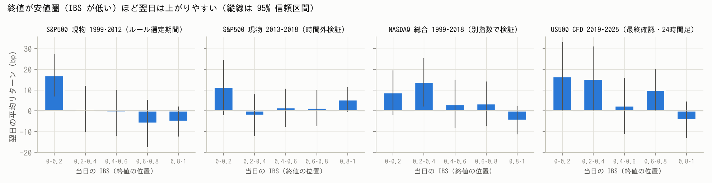
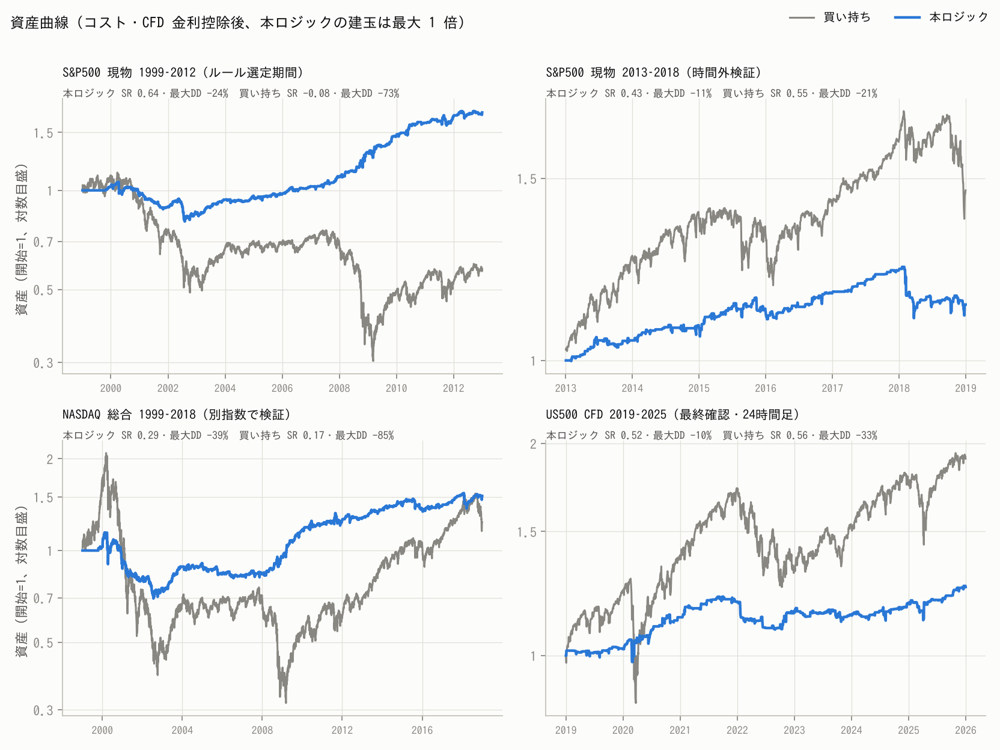
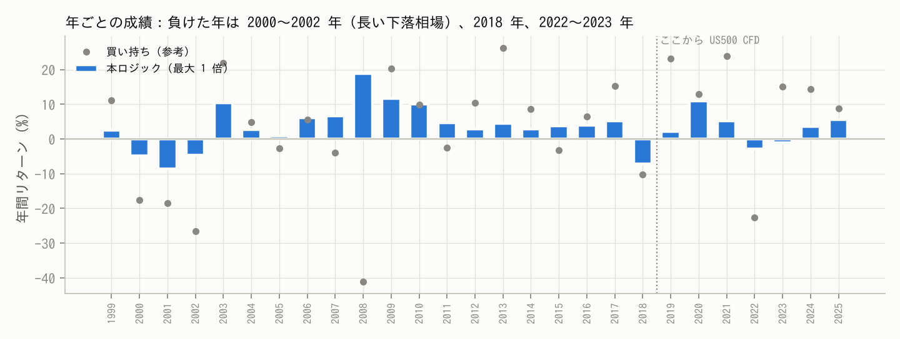
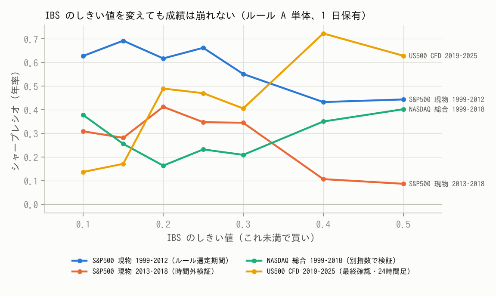
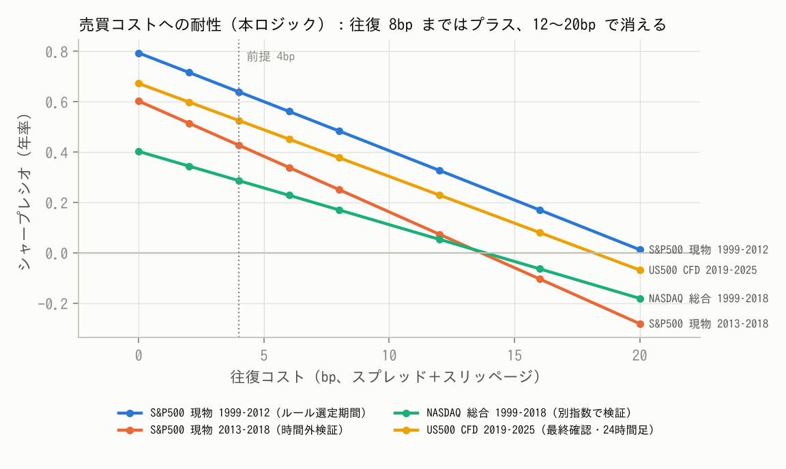

# 指数 CFD 向け EA の優位性検証レポート（IndexReversion_EA）

作成日：2026-11-17　対象：米国株価指数 CFD（US500＝S&P500 が主、NAS100 が副）　時間軸：日足

---

## 0. 結論

**導き出したロジック**は「米国株価指数を、売られすぎた日の終値で買い、反発したら手仕舞う」日足の短期逆張りです。買いのみで、2 つのルールを同じリスク量で並行して動かします。

| ルール | エントリー（日足の確定時） | 手仕舞い | 出典 |
|---|---|---|---|
| A：IBS 逆張り | その日の終値が値幅の下位 20%（IBS＝(終値−安値)/(高値−安値) が 0.2 未満） | 翌日の終値（翌日も IBS が 0.2 未満なら持ち越し） | Pagonidis (2014) |
| B：RSI(2) 押し目買い | 終値が 200 日移動平均より上、かつ RSI(2) が 10 未満 | 終値が 5 日移動平均を上回った日（最長 10 日） | Connors & Alvarez (2008) |

- 共通の損切り：シグナルが出た日の終値 − 3×ATR(10)（ルールごとに独立）
- ナンピン・マーチンゲール・グリッドは使いません。各ルールが持てるポジションは常に 1 つだけです。
- パラメータはすべて文献の値のままで、この研究では一度も最適化していません。

**優位性の根拠**：強制的・機械的な売り（証拠金の追加請求による損切り、レバレッジ型 ETF の引け前の売り、リスク量を一定に保つファンドの売りなど）で終値が一時的に押し下げられ、翌日以降に戻る動きを拾います。売りたい人に流動性を提供する対価です（Nagel 2012）。株式指数は長期的に上昇してきたので、買いだけに絞っています。

**検証結果**（売買コスト往復 4bp と CFD の金利を差し引いた後、建玉は最大 1 倍）

| 検証区分 | 期間 | 役割 | シャープレシオ（95% 区間） | 年率 | 最大 DD | 取引数 | 勝率 |
|---|---|---|---|---|---|---|---|
| S&P500 現物 | 1999–2012 | ルールを選んだ期間 | **0.64**（0.12〜1.14） | 4.0% | −24% | 703 | 60% |
| S&P500 現物 | 2013–2018 | 時間外の検証 | **0.43**（−0.23〜1.14） | 2.1% | −11% | 274 | 64% |
| NASDAQ 総合 | 1999–2018 | 別の指数で検証 | **0.29**（−0.10〜0.73） | 2.1% | −39% | 985 | 58% |
| US500 CFD | 2019–2025 | 最終確認（24 時間取引の日足） | **0.52**（−0.07〜1.08） | 3.2% | −10% | 335 | 58% |

**優位性の強さは「本物だが小さい」です。**

- 4 区分すべてでプラスになりました。パラメータを大きくずらしても崩れません（図 3）。
- ルール選びに使っていない時期（2013〜2025 年の 13 年）だけで見ると、シャープ 0.48、t 値 1.75（片側 p≈0.04）です。
- 34 通りの試行で生じる「たまたま良く見える分」を差し引く補正（Deflated Sharpe Ratio）をかけると、選定期間だけの確からしさは 0.77 です。決定的な証拠ではありません。
- 期待できるリターンは小さめです。建玉最大 1 倍なら年 2〜4% で、リスク設定を上げるとリターンも下落幅も比例して大きくなります（5.3 節）。

---

## 1. 「優位性」の定義

この研究では、次の 3 つを満たすものを「優位性」と呼びます。

1. **理由がある**：誰が、なぜ不利な価格で取引してくれるのかを説明できる。
2. **再現する**：ルールを選んだ期間とは別の時期・別の市場でも、コスト差し引き後にプラスになる。
3. **壊れにくい**：パラメータを少し変えても成績が崩れない（性能の「山」ではなく「台地」になっている）。

「勝率が高い」「バックテストの資産曲線がきれい」は優位性ではありません。ナンピンやマーチンゲールは勝率を 90% 以上に見せられます。しかしそれは、まれに来る大損を先送りしているだけで、期待値は変わりません。むしろコストの分だけ悪化します。

## 2. 優位性の源泉を洗い出す

| 源泉 | 例 | 個人の EA で狙えるか | この研究での扱い |
|---|---|---|---|
| 流動性提供の対価 | 売られすぎからの短期反発（IBS、RSI(2)） | ◎ 日足で十分、コストに強い | **採用** |
| 構造的な資金の流れ | 日中モメンタム（オプション業者のガンマヘッジ、レバレッジ型 ETF の調整）、月末月初の資金流入 | ○（日中モメンタムは 1 分足が必要） | 月末効果は検証して不採用。日中モメンタムはデータ不足で未検証（7 章） |
| 行動の偏り（反応の遅れ） | トレンドフォロー | △ 単一銘柄ではシャープが低い | 200 日線のトレンドは単独では不採用。ルール B のフィルターとして使用 |
| リスクプレミアム | 指数の買い持ち、通貨のキャリー | △ CFD では金利コストが重い | 比較の基準として使用 |
| 情報・速度 | 高頻度取引、ニュース | × 個人には不可 | 対象外 |

## 3. 検証の手順（過剰最適化を防ぐ仕組み）

1. **仮説とパラメータを先に固定しました。** 文献で知られた 7 戦略を、文献の値のまま登録しました。合議制の 5 案も、結果を見る前に定義しています。
2. **データを役割で 4 つに分けました。** ルールは S&P500 1999–2012 の成績だけで選び、残り 3 区分は確認だけに使いました。

   | データ | 内容 | 出所 |
   |---|---|---|
   | S&P500 現物 1999–2018 | 取引所の立会時間の日足（始値・高値・安値・終値） | Python パッケージ `arch` に同梱 |
   | NASDAQ 総合 1999–2018 | 同上 | 同上 |
   | US500 CFD 2013–2025 | Dukascopy の日足（BID、UTC 区切り）。2018 年以降はほぼ 24 時間取引 | Dukascopy |

3. **コストは保守的に見積もりました。** 売買コストは往復 4bp（スプレッドと滑り）です。持ち越しには CFD の金利として、その年の米政策金利に 2.5% を上乗せした年率を 1 泊ごとに課しました。配当調整の受け取りは入れていません。
4. **試した数をすべて記録しました。** 34 通りすべてを記録し、Deflated Sharpe Ratio（Bailey & López de Prado 2014）で補正しました。
5. **頑健性を確かめました。** パラメータの感応度、コストを最大 5 倍にした場合、年別の成績、ブートストラップ（時系列のまとまりを保った再標本化）による信頼区間を調べています。
6. **EA の手続きを照合しました。** MQL のコードを Python に逐語で書き写し、研究用シミュレーターと取引を 1 件ずつ照合しました。US500 CFD 2019–2025 で、エントリー 307 件中 307 件が一致しています。

## 4. 結果

### 4.1 診断：終値の位置（IBS）と翌日の値動き

ルールを選んだ期間（S&P500 1999–2012）では、IBS が 0.2 未満の日の翌日は平均 **+17.1bp**（t=3.31、823 日）でした。全日平均は +1.4bp なので、大きな差です。逆に IBS が 0.8 以上の日の翌日は −5.2bp でした。

RSI(2) でも同じ傾向が出ています。5 以下の翌日は +30.6bp（t=2.2）、95 超の翌日は −16.2bp（t=−3.2）です。他の 3 区分でも、IBS 0.2 未満が平均を上回る点は共通していました。

### 4.2 事前登録した戦略の比較（シャープレシオ、コスト差し引き後）

| 戦略 | 内容 | S&P 1999–2012 | S&P 2013–2018 | NASDAQ | US500 CFD 2019–2025 |
|---|---|---|---|---|---|
| B0 買い持ち | 常に 1 倍の買い（CFD の金利込み） | −0.08 | 0.55 | 0.17 | 0.56 |
| S1 IBS 1 日 | IBS<0.2 で買い、翌日の終値で決済 | 0.62 | 0.41 | 0.16 | 0.49 |
| S2 IBS 保有 | IBS<0.2 で買い、前日の高値を超えて引けたら決済 | 0.42 | 0.58 | 0.25 | 0.49 |
| S3 RSI(2) | 200 日線より上で RSI(2)<10 なら買い、5 日線の上で決済 | 0.31 | 0.25 | 0.41 | 0.45 |
| S4 Double 7s | 200 日線より上で 7 日安値なら買い、7 日高値で決済 | 0.37 | 0.64 | 0.29 | 0.18 |
| S5 月末月初 | 月末 2 日前の終値から月初 3 日目の終値まで買い | 0.26 | **−0.13** | 0.25 | 0.05 |
| S6 200 日線 | 200 日線より上なら買い | **−0.11** | 0.43 | 0.29 | 0.47 |
| S7 IBS 売り | IBS>0.8 で売り（逆張りの売り側） | 0.19 | **−1.22** | 0.10 | 0.12 |
| **C1 IBS＋RSI(2)** | **S1 と S3 を半分ずつ（＝採用）** | **0.64** | **0.41** | **0.31** | **0.60** |
| C2 合議制 | S1〜S4 を 4 分の 1 ずつ | 0.58 | 0.60 | 0.33 | 0.50 |
| C3 合議制＋変動調整 | C2 を変動率で建玉調整 | 0.52 | 0.65 | 0.52 | 0.40 |
| C4 IBS 保有＋トレンド | S2 に 200 日線の条件を追加 | 0.32 | 0.61 | 0.31 | 0.41 |
| C5 合議制＋月末月初 | C2 に S5 を追加 | 0.59 | 0.53 | 0.36 | 0.48 |

- 選定期間のシャープが最も高かったのは C1（0.64）なので、事前に決めた手順どおり C1 を採用しました。C2・C5・S1 との差は統計的には誤差の範囲です。
- 買いの逆張り（S1〜S4）は 4 区分すべてでプラスでした。月末月初（S5）と売り側（S7）は時間外の検証で崩れたため不採用です。200 日線（S6）は選定期間でマイナスでした。
- 合議制にすると最大 DD が大きく下がりました。たとえば S1 単体は S&P 選定期間で −34%、NASDAQ で −62% でしたが、C1 ではそれぞれ −19%、−38% です。

### 4.3 採用ロジック（EA と同じ手続き、損切り込み）の成績

| 年 | 本ロジック | 年 | 本ロジック | 年 | 本ロジック |
|---|---|---|---|---|---|
| 1999 | +2.6% | 2008 | +18.9% | 2017 | +5.2% |
| 2000 | −4.9% | 2009 | +11.6% | 2018 | −7.3% |
| 2001 | −8.6% | 2010 | +10.0% | 2019（CFD） | +2.1% |
| 2002 | −4.7% | 2011 | +4.6% | 2020 | +11.0% |
| 2003 | +10.4% | 2012 | +2.8% | 2021 | +5.1% |
| 2004 | +2.7% | 2013 | +4.6% | 2022 | −2.9% |
| 2005 | +0.9% | 2014 | +2.9% | 2023 | −1.1% |
| 2006 | +6.0% | 2015 | +3.8% | 2024 | +3.6% |
| 2007 | +6.7% | 2016 | +4.0% | 2025 | +5.6% |

1999〜2018 年は S&P500 現物、2019 年以降は US500 CFD のデータです。建玉は最大 1 倍です。

- **弱点**：2000〜2002 年のように下げが何年も続く相場では、押し目買いが続けて失敗し、年 −5〜−9% の損失になります。2018 年（年末の急落）と 2022〜2023 年も小幅なマイナスでした。
- **強み**：暴落後の反発局面（2003 年、2008〜2010 年、2020 年）で大きく稼いでいます。買い持ちが −40% 以上沈んだ 2008 年も +18.9% でした。

### 4.4 頑健性

- **パラメータ**：IBS のしきい値（0.1〜0.5）、保有日数（1〜5 日）、RSI(2) のしきい値（5〜30）を動かしても、4 区分すべてでシャープはプラスのままでした。特定の値だけが良いわけではないので、値を選んだことによる見せかけではありません。
- **コスト**：往復コストが 8bp ならシャープは 0.17〜0.48、12bp で 0.05〜0.33 です。16〜20bp でほぼ消えます。US500 が 6,000 のとき 4bp は約 2.4 ポイント、8bp は約 4.8 ポイントです。スプレッドが 0.5〜1 ポイントの一般的な業者なら余裕があります。CFD の金利上乗せを 2.5% から 4% に上げても、シャープの低下は 0.03〜0.05 にとどまりました。
- **損切り**：ATR の 3 倍の損切りは成績をほとんど変えません（発動は全取引の約 2〜6%）。ATR の 2 倍まで狭めると悪化しました。逆張りで損切りを狭くするのは不利です。そのため損切りは「事故の保険」として広めに置いています。
- **統計**
  - 選定期間でシャープが 0 以下になる確率（ブートストラップ）は 0.6% です。
  - 時期の重ならない未使用期間（2013–2025）の確率的シャープレシオ（PSR）は 0.963 です。
  - 34 試行を考慮した Deflated Sharpe Ratio は 0.77 でした。
  - S&P と NASDAQ の日次損益の相関は 0.73 と高く、2 指数に分けても分散効果は小さいです（50/50 でシャープ 0.44）。

## 5. EA の仕様（`mql5/IndexReversion_EA.mq5`、`mql4/IndexReversion_EA.mq4`）

### 5.1 動作

- 判定は日足が確定した直後の最初のティックで行います。直前に確定した日足で IBS・RSI(2)・SMA・ATR を計算し、成行で発注します。チャートの時間足は何でもかまいません（内部で日足を読みます）。
- ルール A はマジックナンバー＋1、ルール B は＋2 の独立したポジションです。それぞれ業者側の損切り（シグナル終値 − 3×ATR(10)）を持ちます。
- 次の場合は新規エントリーしません。決済は行います。
  - EA を起動した日の途中（遅れたエントリーを防ぐため）
  - 日足の始まりから `InpMaxWaitMinutes` 分を過ぎた
  - スプレッドが `InpMaxSpreadPoints` を超えたまま待ち時間が過ぎた
- 処理済みの日足はターミナルのグローバル変数に保存します。再起動しても二重には処理しません。
- 指標は組み込み関数を使わず、ローソク足から直接計算します（Python 版と同じ式）。
- 日曜に短い日足ができる業者（GMT 基準のサーバー）では、その足を判定に使いません。

### 5.2 必要な口座

MT5 は**両建て（ヘッジング）口座**が必要です。ネッティング口座では起動を止めます。MT4 はそのまま動きます。

### 5.3 リスク設定と成績の目安

建玉の量は「損切りに達したら資産の何 % を失うか」（`InpRiskPercent`、ルールごと）で決めます。変動が大きいときは自動的に小さくなります。

| 設定 | S&P 1999–2012 | S&P 2013–2018 | NASDAQ 1999–2018 | US500 CFD 2019–2025 |
|---|---|---|---|---|
| 1%/ルール（初期値） | 年 1.8%・DD −8%・SR 0.70 | 年 1.4%・DD −7%・SR 0.42 | 年 1.0%・DD −9%・SR 0.39 | 年 0.9%・DD −5%・SR 0.35 |
| 2%/ルール | 年 3.5%・DD −15% | 年 2.6%・DD −14% | 年 2.0%・DD −17% | 年 1.7%・DD −9% |
| 3%/ルール | 年 5.2%・DD −22% | 年 3.4%・DD −20% | 年 2.8%・DD −24% | 年 2.5%・DD −13% |
| 参考：固定 0.5 倍/ルール | 年 4.0%・DD −24%・SR 0.64 | 年 2.1%・DD −11%・SR 0.43 | 年 2.1%・DD −39%・SR 0.29 | 年 3.2%・DD −10%・SR 0.52 |

- リスク % 方式は、暴落局面での DD を大きく抑えます（NASDAQ の 2000〜2002 年など）。その代わり、変動の大きい時期に稼ぐ US500 CFD 2019–2025 ではシャープが下がりました（0.52 → 0.35）。どちらが良いかはデータからは決められません。初期値は、1 回の損失の上限が業者に関係なく決まるリスク % 方式にしています。
- 1% は「まず動作を確かめる」ための控えめな値です。上げるときは、最大 DD がほぼ比例して増えることを前提にしてください。

## 6. 限界とリスク

- **データの制約**
  - 日中の足、FX、ゴールドのデータは、この環境から取得できませんでした（Dukascopy は自動取得を制限していて、回避はしていません）。そのため検証は米国株価指数の日足に限られます。
  - US500 CFD のデータは UTC 0 時区切りの日足です。多くの MT4/MT5 業者の日足（ニューヨーク 17 時区切り）とは 2〜3 時間ずれます。区切りが違っても効果は出ましたが、業者のデータでの再確認を勧めます（`research/run_all.py --csv`）。
- **効果は時期によって大きく変わります。** 長い下落相場や 2022〜2023 年のような年は負けます。数年単位の停滞はありうると考えてください。
- **統計的な確からしさは中程度です。** 未使用期間でプラスでしたが、補正後の値は決定的ではありません。公表後に効果が薄れる可能性もあります。IBS は 2014 年、RSI(2) は 2008 年に公表されましたが、公表後のデータでもプラスでした。
- **コストと金利**：スプレッドが広い業者や、CFD の金利上乗せが大きい業者では成績が落ちます。くりっく株 365 などの国内の取引所 CFD は、金利と配当の扱いが異なります。
- **未コンパイル**：EA はこの環境では MetaEditor でコンパイルしていません。手続きは Python の逐語版で取引 1 件ずつ照合済みです。お手元で最初にコンパイルし、ストラテジーテスターで確認してください。
- **投資判断はご自身で**：本レポートは研究結果で、将来の利益を保証するものではありません。実口座の前に、デモ口座で数か月のフォワードテストを行ってください。

## 7. 次に検証すべき候補

1. **日中モメンタム（ノイズ帯ブレイクアウト）**
   - 内容：寄り付きからの値動きが、過去 14 日の平均的な変動幅（ノイズ帯）を超えたら、その方向へ順張りし、引けで決済します。
   - 証拠：SPY 2007–2024 でシャープ 1.33 と報告されています（Zarattini, Aziz & Barbon 2024）。原因として、オプション業者のヘッジが値動きを増幅することが示されています（Baltussen et al. 2021）。
   - 本ロジックとの関係：持ち越さないので CFD 金利がかからず、逆張りとの相関も低いと考えられます。組み合わせの最有力候補です。
   - 必要なもの：US500/NAS100 の 1 分足（数年分）。
2. **他の指数への展開**：GER40、JP225、US30 に同じロジックを当てる検証です。業者の日足 CSV があれば `run_all.py --csv` ですぐ確認できます。
3. **FX の時間帯効果**：各国通貨は、その国の市場が開いている時間帯に下がりやすいという報告があります（Breedon & Ranaldo 2013）。1 時間足が必要です。

## 参考文献

- Bailey, D. & López de Prado, M. (2012) "The Sharpe Ratio Efficient Frontier", *Journal of Risk* 15(2).
- Bailey, D. & López de Prado, M. (2014) "The Deflated Sharpe Ratio", *Journal of Portfolio Management* 40(5).
- Baltussen, G., Da, Z., Lammers, S. & Martens, M. (2021) "Hedging demand and market intraday momentum", *Journal of Financial Economics* 142(1).
- Breedon, F. & Ranaldo, A. (2013) "Intraday patterns in FX returns and order flow", *Journal of Money, Credit and Banking* 45(5).
- Cheng, M. & Madhavan, A. (2009) "The Dynamics of Leveraged and Inverse Exchange-Traded Funds", *Journal of Investment Management* 7(4).
- Connors, L. & Alvarez, C. (2008) *Short Term Trading Strategies That Work*. TradingMarkets.
- Faber, M. (2007) "A Quantitative Approach to Tactical Asset Allocation", *Journal of Wealth Management* 9(4).
- Gao, L., Han, Y., Li, S. & Zhou, G. (2018) "Market intraday momentum", *Journal of Financial Economics* 129(2).
- Lakonishok, J. & Smidt, S. (1988) "Are Seasonal Anomalies Real? A Ninety-Year Perspective", *Review of Financial Studies* 1(4).
- McConnell, J. & Xu, W. (2008) "Equity Returns at the Turn of the Month", *Financial Analysts Journal* 64(2).
- Moskowitz, T., Ooi, Y. H. & Pedersen, L. H. (2012) "Time series momentum", *Journal of Financial Economics* 104(2).
- Nagel, S. (2012) "Evaporating Liquidity", *Review of Financial Studies* 25(7).
- Pagonidis, A. (2014) "The IBS Effect: Mean Reversion in Equity ETFs", NAAIM.
- Politis, D. & Romano, J. (1994) "The Stationary Bootstrap", *Journal of the American Statistical Association* 89(428).
- Zarattini, C., Aziz, A. & Barbon, A. (2024) "Beat the Market: An Effective Intraday Momentum Strategy for S&P500 ETF (SPY)", SSRN.
